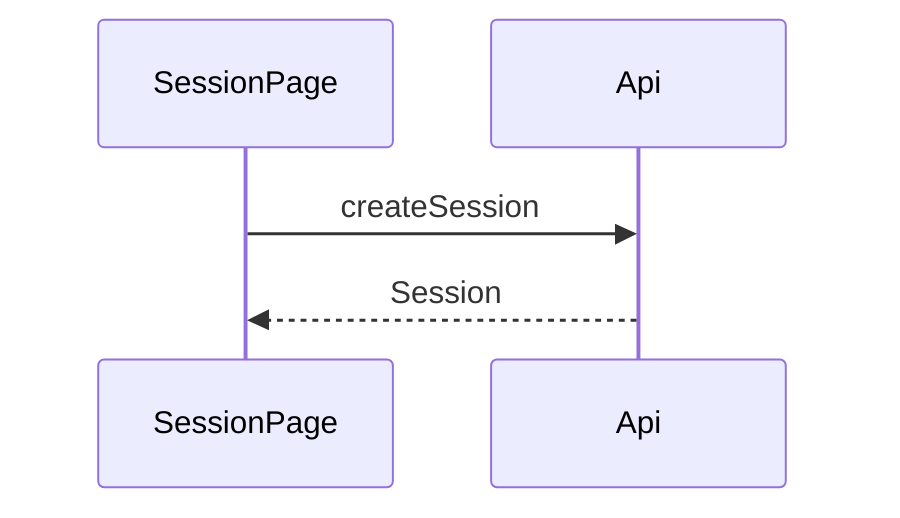
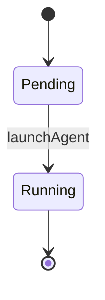

Show the shape of a change for a reader who will never open the code: pseudocode, never real source.

Use the project's domain language.

## Process

1. List every change — new and modified models, modules, flows, and files — and group them by area.

   Done when every change is accounted for.

2. Pick the smallest set of views that makes the changes clear. See [Views](#views).

   Done when every change appears in a view.

3. Lead each view with one sentence that says what it shows. When there is more than one area, put each area under its own heading at the level the surrounding document uses. Order the views so the story is easiest to follow — for example, establish a model before the flow that uses it.

   Done when every view has its sentence and no view depends on one that comes after it.

4. Before returning, load the removing-ai-tells skill and apply it to the prose. Keep each view's sentence.

   Done when the prose is cleaned of AI tells and every view is unchanged.

## Notation

Strip the language syntax and keep the real names of functions, types, and files.

A model reads:

```text
Session
  prompt: string
```

Write primitives in lowercase (`string | number`) and type aliases in PascalCase (`SessionStatus | AgentKind`).

A function reads:

```text
createSession({ prompt: string }): Session

updateSession({
  prompt: string
  status: SessionStatus
}): Session
```

Put parameters on one line when there is one, and one per line when there are two or more.

Group variants of one operation under a shared name:

```text
getSession
  fromId({ id: uuid }): Session
  fromPrompt({ prompt: string }): Session
```

Keep only the calls, files, fields, states, and boundaries the reader needs. Omit everything else.

When a view comes from one file, put the file path in inline code on its own line above the code block:

`src/sessions/createSession.ts`

```text
createSession({ prompt: string }): Session
```

Use `#` comments inside a view only for boundaries that change within it, such as packages in a component tree.

## Views

Data and API contracts — tables, columns, and endpoint request and response shapes — as pseudocode, not SQL or JSON:

```text
sessions               # table
  id: uuid             # primary key
  prompt: string
  status: SessionStatus

POST /sessions({ prompt: string }): Session
GET /sessions/:id: Session
```

Logic or an algorithm as pseudocode:

```text
on(prompt)
  if prompt is unchanged
    return
  persistPrompt(prompt)
```

Runtime control flow as a call tree:

```text
submitForm
  createSession
    persistPrompt
  launchAgent
  navigateToSession
```

UI structure as a component tree, with the hooks, state, and package boundaries that matter:

```text
SessionPage      # apps/web
  useSessionEvents
  SessionToolbar # packages/ui
```

File responsibility or a broad refactor as a shallow file tree:

```text
src/
├── sessions/  # owns session state
└── transport/ # sends requests
```

Component interaction or data flow as a Mermaid sequence diagram:



A state machine as a Mermaid state diagram:



### Diffs

Use a diff when the surrounding shape already exists and the point is what changes; show the whole shape when most of it is new, or when a diff would hide ownership or order. Match the diff to the view it changes.

A contract:

```diff
 sessions
   id: uuid
   prompt: string
+  status: SessionStatus

-POST /sessions({ prompt: string }): Session
+POST /sessions({
+  prompt: string
+  agent: AgentKind
+}): Session
```

Control flow:

```diff
 on(prompt)
+  if prompt is unchanged
+    return
   persistPrompt(prompt)
```
